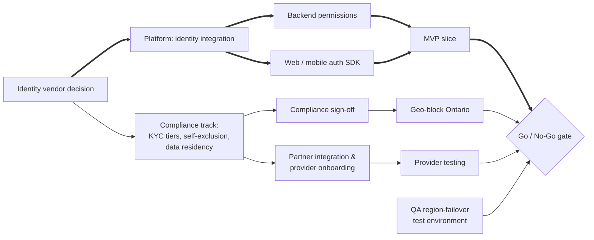

# Delivery Plan: Authentication & Authorization for a Multi-Tenant Gaming Platform

`Interview exercise` · Technical Project Manager · iGaming

**Files:** [Assignment brief](./Assignment-Brief.pdf) · [My full response (handwritten)](./My-Response.pdf)

---

## The Brief

Deliver the authentication and authorization workstream for a multi-tenant online gaming platform where several brands share infrastructure.

* **Fixed launch date** set by the licence window (T-0). It cannot move.
* **First market:** Canada, excluding Ontario. LATAM follows.
* **Four teams:** platform (identity & permissions), backend services, web & mobile clients, partner integrations (third-party game providers).
* **Outside engineering:** compliance and legal must sign off on player identity, KYC and responsible gaming.
* **Architecture already decided:** bought identity provider (vendor not yet chosen), permissions in Postgres, enforcement at the Kubernetes ingress.

## My Approach

Ship an MVP slice first instead of building everything, and cut scope rather than quality when the date is fixed.

### Phased plan (~16 weeks, T-16 → T-0)

| Phase | Window | Focus | Done means |
|---|---|---|---|
| 1. Foundation | T-16 → T-12 | Vendor contract, KYC compliance scope, token-strategy sign-off, QA environment | Contract signed · token strategy documented · compliance doc in review · platform team working in sandbox |
| 2. Permission build | T-12 → T-8 | Integrate vendor identity, Postgres permission model, backend APIs; web & mobile integrate auth SDK in parallel | A user can authenticate via the vendor IdP in sandbox and receive a permission token Postgres recognises |
| 3. MVP slice | T-8 → T-6 | One brand, Canada (ex-Ontario), web: log in, permission check, one real-money bet, enforced at ingress | A real player can log in and place a bet in staging with full auth & permissions |
| 4. Partners & compliance | T-6 → T-4 | Onboard remaining brands/partners, KYC tiers, Ontario exclusion | Remaining partners onboarded · KYC for all brands · Ontario correctly excluded |
| 5. Testing | T-4 → T-2 | Load, security, region-failover, data-residency validation, rollback plan | SLAs met at peak load · failover tested · compliance sign-off after testing |
| 6. Launch readiness | T-2 → T-1 | Go/no-go checklist, freeze non-critical changes, on-call & escalation plan, final regression | Every checklist item done · leadership approves launch |
| 7. Launch | T-1 → T-0 | Go live in Canada (ex-Ontario); LATAM fast-follow on the same platform | Live in prod · monitoring & logs in place · rollback ready · team on call |

### Critical path

**Top 3 dependencies I'd worry about:**
1. **Vendor decision:** it blocks three of the four teams.
2. **Compliance sign-off:** it's non-negotiable.
3. **Teams I have no direct authority over** (partners, compliance) and their readiness.

### RAID log: top risks

| Risk | Impact | Trigger / action |
|---|---|---|
| Vendor decision delayed past T-13 | High: blocks 3 teams | No signed contract by T-13 → escalate to stakeholders |
| Token strategy unresolved | Medium: blocks API & SDK design | Still open after 15 days → give 5 more days, then a single named decision-maker decides |
| Compliance sign-off slips | High: regulatory blocker | No sign-off by T-4, or no document by T-8 |
| Priority game-provider integration slips (not our team) | Medium: smaller game catalogue at launch | Fails conformance testing twice, or sandbox not ready |
| No QA environment for region failover | High: can't verify resilience before launch | Not provisioned by T-6 → raise as a blocking risk |
| Ingress enforcement misses latency SLA | High: player-facing performance | Load test at T-3 shows p95 latency above the agreed SLA |
| Compliance change request after code freeze | Medium: threatens freeze & QA coverage | Sprint velocity below 70% of plan by mid phase 3 |
| Gap in Ontario geo-block logic | High: direct regulatory violation | Any Ontario-sourced transaction not blocked |

### Go / No-Go checklist (each item has a hard "No" trigger)

* Auth & permissions verified (ex-Ontario) → **No** on any failure
* Vendor contract signed with SLA & support model → **No** if unsigned or no committed SLA
* KYC logic verified → **No** on any misclassification
* Self-exclusion tested end-to-end → **No** if a self-excluded test player can place a bet
* Data residency validated → **No** if any player data is stored outside the scoped region
* Ontario geo-block verified across web, mobile & partners → **No** if anything from Ontario isn't blocked
* Load & security tests passed at expected peak → **No** on SLA breach or high/critical vulnerability
* Priority provider testing passed → **No** on failed conformance
* Rollback plan tested in staging → **No** if untested or failing
* On-call & escalation confirmed for launch week → **No** if any critical-path system has no named owner

### Sample amber stakeholder update

> **Headline:** On track for the MVP milestone, but the identity vendor contract is still unsigned at T-9 and is now the top risk.
> **What's good:** Platform and backend teams are unblocked on Postgres permission modelling using a mocked IdP.
> **Next checkpoint:** Vendor signature status and MVP progress, next Friday.

### Judgement calls

* **Engineering needs three more weeks, and the date is fixed:** Protect the MVP that meets the minimum client requirements, and move non-critical items to fast-follow. Be specific with leadership about which 3 weeks of work is being cut.
* **Two architects disagree on token strategy (open 10 days):** Hear both positions on one call, compare them with data, then take it to a single named decision-maker and align both architects on the outcome.
* **Game provider integration slips (not my team):** Decide whether it's critical. If not, deprioritise it and communicate that. If it is, get a committed timeline and find out what scope or capacity they need.
* **Compliance asks for a change after code freeze:** Ask in writing whether it is a hard regulatory requirement or a nice-to-have. A nice-to-have goes post-launch. A hard requirement gets sized for timeline and effort, and stakeholders decide with that data.
* **Vendor contract unsigned at T-6 weeks:** Covered in the RAID log. Set a hard decision date two weeks before the trigger, get procurement and legal to commit to it, run weekly checkpoints, and escalate with the cost of delay and the launch-date risk.
* **No QA environment for region failover:** Treat it as a blocking risk and raise it. In parallel, run a lightweight failover test against an existing environment, and escalate to stakeholders with the risk written down.
