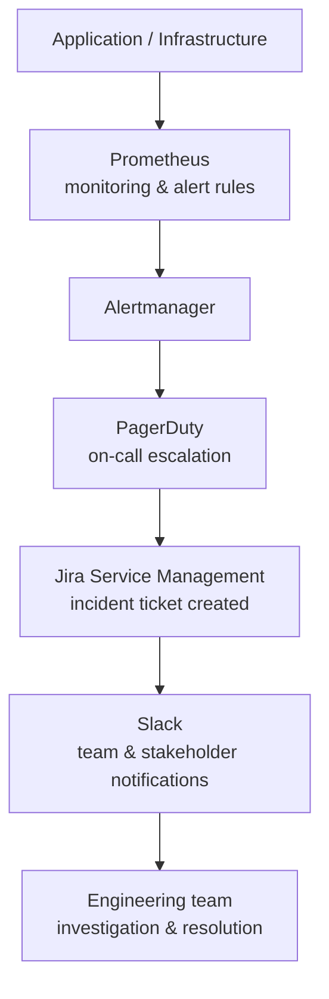

# Jira Service Management Integration with Prometheus, PagerDuty & Slack

`Comprinno Technology` · Associate Project Manager · Jan 2023 – Jul 2024

## Overview

As part of improving incident management and operational visibility, I worked with cross-functional teams to define and deliver an integrated workflow between Jira Service Management (JSM), Prometheus, PagerDuty, and Slack.

The objective was to reduce incident response time, automate ticket creation, improve stakeholder communication, and establish a centralized incident management process.

---

## Business Problem

The organization faced several operational challenges:

* Critical alerts were monitored across multiple tools.
* Incident reporting was largely manual.
* Engineering teams experienced delays in identifying and assigning incidents.
* Stakeholders lacked real-time visibility into ongoing production issues.
* Mean Time to Resolution (MTTR) was higher than desired.

---

## Product Goal

Create an automated incident management workflow that:

* Detects production issues through Prometheus.
* Creates and routes incidents through PagerDuty.
* Automatically generates Jira Service Management tickets.
* Notifies relevant teams through Slack.
* Provides end-to-end incident traceability.

---

## My Role

Associate Project Manager, owning requirements, backlog and delivery for this workflow

### Responsibilities

* Gather requirements from Engineering, Operations, and Support teams.
* Define incident lifecycle workflows.
* Prioritize automation requirements within the backlog.
* Create user stories and acceptance criteria.
* Coordinate delivery across engineering and platform teams.
* Facilitate sprint planning and stakeholder reviews.

---

## Solution Design

### Before: the manual process

1. Monitoring detected an issue.
2. The operations team reviewed alerts by hand.
3. Engineers were contacted through calls or emails.
4. Incident tickets were created manually.
5. Stakeholders were informed separately.
6. Resolution updates were tracked across different tools.

Every handoff added delay and a chance of miscommunication.

### After: the automated incident flow

1. Prometheus detects a threshold breach.
2. AlertManager sends an alert to PagerDuty.
3. PagerDuty creates an incident and triggers escalation policies.
4. Jira Service Management automatically creates an incident ticket.
5. Slack notifications are sent to relevant channels.
6. Engineering teams collaborate and update ticket status.
7. Resolution updates are synchronized across tools.

---

## Key Features

### Automated Incident Creation

* Auto-generate JSM incidents from PagerDuty alerts.
* Standardized incident templates.
* Reduced manual effort.

### Smart Routing

* Priority-based assignment rules.
* Service ownership mapping.
* Escalation workflows.

### Slack Notifications

* Dedicated incident channels.
* Real-time status updates.
* Stakeholder visibility.

### Operational Dashboards

* Incident trends.
* Resolution metrics.
* SLA monitoring.

---

## Sample User Story

**As an Operations Engineer**

I want a Jira Service Management ticket to be created automatically when PagerDuty receives a critical alert

So that incident response can begin immediately without manual intervention.

### Acceptance Criteria

* Ticket created within 1 minute of alert generation.
* Priority mapped from PagerDuty severity.
* Slack notification sent automatically.
* Incident owner assigned based on service mapping.

---

## Success Metrics

* Reduced manual incident creation effort.
* Improved incident visibility.
* Faster stakeholder communication.
* Reduced Mean Time to Acknowledge (MTTA).
* Improved SLA compliance.

---

## Outcome

The integrated workflow streamlined incident management, improved cross-team collaboration, and established a scalable process for handling production incidents across engineering and support teams.

---

## Related

* [Jira Service Desk walkthrough (video)](../../Comprinno/Jira%20service%20desk.pptx%20-%20Google%20Slides.webm)
* [Exceptional Execution Certificate, Comprinno 2023](../../Comprinno/Gaurav.png)
